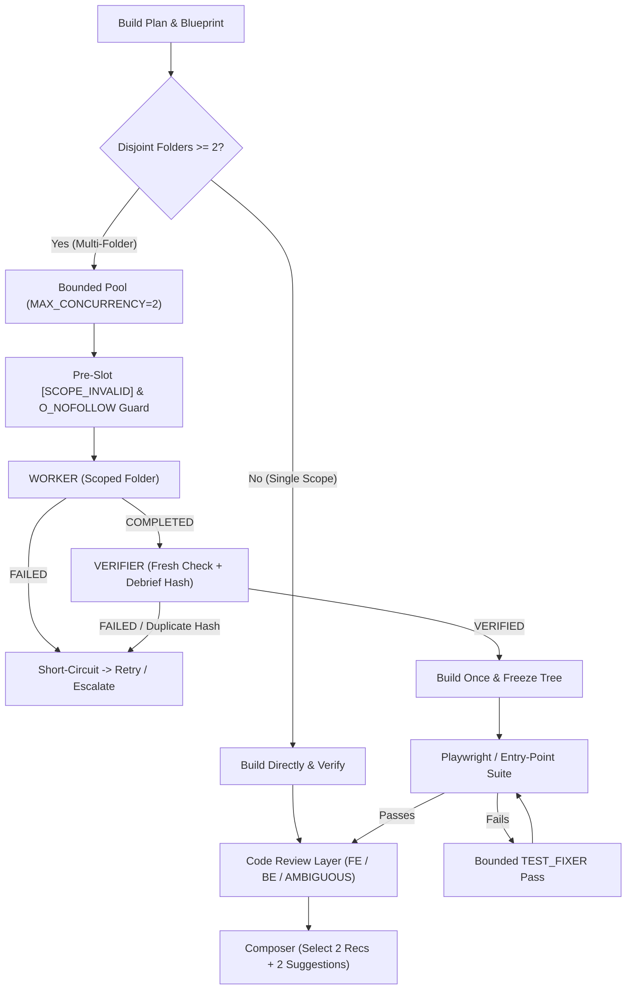

# Surgical Orchestration

## Overview

Coordinated, sandboxed multi-agent build orchestrator for changes spanning multiple directories. Every parent folder maps to one `WORKER`/`VERIFIER` pair bounded by `MAX_CONCURRENCY = 2`, strict `[SCOPE_INVALID]` realpath/symlink containment, `AbortSignal` timeouts, `FAILED`-worker non-promotion, 75% context compaction, debrief-hash loop detection, and a post-build `2 + 2` Code Review Composer.

## When to Use

- Changes touch 2 or more disjoint directories that can be built and verified in parallel.
- A build plan requires isolated folder scopes, deterministic loop protection, integration test recovery, and consolidated post-build code review.

## When Not to Use

- All edits land in a single parent folder or tightly coupled file set; build directly instead and invoke reviewers read-only afterward (`1-folder-per-agent` has zero parallel gain).
- Tasks need only root-cause discovery or read-only auditing; use `surgical-investigation` or `surgical-audit`.

## Architecture



## Procedure

### Step 1: Blueprint Plan & Scope Rule

1. Validate the `BuildPlan` against [`references/build-plan-schema.json`](references/build-plan-schema.json) and record claims in [`references/blueprint-plan-format.md`](references/blueprint-plan-format.md).
2. **Single-scope rule (`Step 1a`):** If every path resolves to one `parentFolder`, skip `WORKER`/`VERIFIER` fan-out, implement directly, run verification gates, and run read-only post-build review in Step 5.
3. For 2+ disjoint folders, initialize a `JobCard` (`PENDING`), capping active dispatches at `ORCHESTRATOR_CONFIG.MAX_CONCURRENCY` (`2`) and cycles at `MAX_REVISION_CYCLES` (`3`). When spawning multiple parallel workers in one repository, prefer separate `git worktree` paths per worker.

### Step 2: Scoped Worker/Verifier Loop

1. **Pre-slot security (`references/security.ts`):** Call `assertScopeBoundary()` / `resolveScopedPath()` *before* acquiring an active slot in `SubagentManager`. Reject empty strings, `\0` bytes, multi-level or dangling symlinks, and sibling-prefix escapes with `[SCOPE_INVALID]`. Read scoped files via `openScopedFile()` (`O_NOFOLLOW` + `fstatSync`). Always release active slots in `try/finally`.
2. **Cancel & compact:** Thread an `AbortSignal` (`SUBAGENT_TIMEOUT_MS = 180000`) into every dispatch (`references/subagent-manager.ts`). Before spawning, compact verified ledger entries with `ContextCompactor` (`references/compactor.ts`) when `COMPACTION_TOKEN_THRESHOLD` (`0.75`) is exceeded.
3. **Strict non-promotion:** If `WORKER` returns `FAILED`, record feedback, consume an attempt, and short-circuit **before** dispatching `VERIFIER`.
4. **Loop guard:** Hash every debrief (`references/debrief.ts`) and escalate jobs that emit duplicate debrief hashes (`loopGuardIsDuplicateHash`). Use `serializeJobCard()` before persisting or validating against [`references/jobcard-schema.json`](references/jobcard-schema.json).

### Step 3: Build Freeze & Entry-Point Tests

1. **Build once, freeze the tree:** Complete production builds before running tests; never mutate source files mid-suite (content-hashed JS module imports must stay consistent across the tree; see [`references/pitfalls.md`](references/pitfalls.md)).
2. **Drive real controls:** Tests must click or keyboard real UI entry points rather than calling global helpers so strict CSP or event-wiring regressions fail loudly.
3. **Bounded recovery:** On test failure, dispatch one bounded `TEST_FIXER` (`references/test-fixer.ts`) scoped only to test files and docs, hash its debrief, and re-run verification.

### Step 4: Frozen-Tree Review & `2 + 2` Composer

1. Freeze the commit or diff before dispatching reviewers; discard or re-verify stale findings if code changed.
2. Classify files with unified `defaultClassifyFile()` (`references/classifier.ts`: `FRONTEND`, `BACKEND`, or `AMBIGUOUS` covering both `/dir/` and path-start `dir/`, including `convex/`). Route `AMBIGUOUS` files to both `FRONTEND_REVIEWER` and `BACKEND_REVIEWER`.
3. Collect `recommendations` and `suggestions` (`parseSubagentResult` in `references/hermes-adapter.ts`) and reduce via `compose()` (`references/review-layer.ts`) to **at most 2 recommendations + 2 suggestions**.

## Verification and CLI

```bash
python3 -B scripts/conform.py
npm run typecheck && npm test && npm run bench
npx tsx references/surgical-orchestration.ts --dry-run references/build-plan.json
npx tsx references/surgical-orchestration.ts --review references/build-plan.json
```

Importing `references/surgical-orchestration.ts` programmatically never invokes `main()` (`isCliEntryPoint()` guard). For TS verification traps and mirror hygiene, see [`references/verify-skill-typescript.md`](references/verify-skill-typescript.md).

## References

| Asset | Purpose |
| --- | --- |
| [`references/orchestrator.ts`](references/orchestrator.ts) | Public barrel re-exporting engine, manager, compactor, classifier, and review types |
| [`references/engine.ts`](references/engine.ts) | Concurrent bounded worker pool, `FAILED` short-circuit, and test-fixer orchestration |
| [`references/subagent-manager.ts`](references/subagent-manager.ts) | Pre-slot scope validation, `try/finally` slot release, and `AbortSignal` timeouts |
| [`references/security.ts`](references/security.ts) | `[SCOPE_INVALID]` containment checks, `resolveScopedPath`, and `openScopedFile` (`O_NOFOLLOW`) |
| [`references/review-layer.ts`](references/review-layer.ts), [`references/classifier.ts`](references/classifier.ts) | Dual-lane `StandardCodeReviewer`, unified `defaultClassifyFile`, and `compose()` `2 + 2` reducer |
| [`references/compactor.ts`](references/compactor.ts), [`references/debrief.ts`](references/debrief.ts), [`references/types.ts`](references/types.ts) | Token compaction, SHA-256 loop guard, shared types, and `serializeJobCard()` |
| [`references/instructions.ts`](references/instructions.ts), [`references/test-fixer.ts`](references/test-fixer.ts), [`references/hermes-adapter.ts`](references/hermes-adapter.ts), [`references/surgical-orchestration.ts`](references/surgical-orchestration.ts) | Prompt builders, bounded `TEST_FIXER`, Hermes/dry-run adapters, and guarded CLI |
| [`references/jobcard-schema.json`](references/jobcard-schema.json), [`references/debrief-schema.json`](references/debrief-schema.json), [`references/subagent-exit-schema.json`](references/subagent-exit-schema.json), [`references/build-plan-schema.json`](references/build-plan-schema.json) | Draft `2020-12` strict (`unevaluatedProperties: false`) schemas |
| [`references/orchestrator-prompt.md`](references/orchestrator-prompt.md), [`references/subagent-prompt.md`](references/subagent-prompt.md), [`references/blueprint-plan-format.md`](references/blueprint-plan-format.md) | Orchestrator/subagent prompts and verified-fact blueprint specification |
| [`references/pitfalls.md`](references/pitfalls.md), [`references/verify-skill-typescript.md`](references/verify-skill-typescript.md), [`references/verify-then-sync.md`](references/verify-then-sync.md), [`references/verify-then-sync-drift-triage.md`](references/verify-then-sync-drift-triage.md), [`references/verify-then-sync-parallel-push.md`](references/verify-then-sync-parallel-push.md) | Field pitfalls, TS/tsx verification recipe, and post-refactor verification/sync workflows |

## Related Skills

- `surgical-implementation` — single-scope structured build and gate execution.
- `surgical-audit` — zero-mutation 10-lens diagnostic audit before or after implementation.
- `surgical-investigation` — read-only forensic investigation and scope discovery.
- `surgical-building` — procedural 3D/spatial orchestration using shared sandbox contracts.

## Author

TeacherEvan, Hermes Agent (based on a Gemini AI architectural review)

## License

MIT — see [`LICENSE`](LICENSE).
